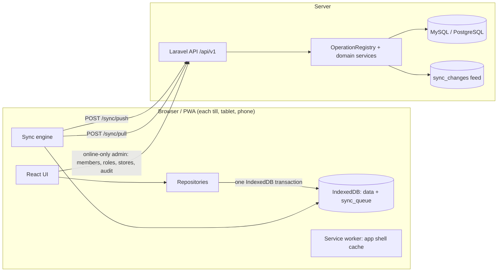

# Architecture

## Overview



**The device database is the operational database.** Screens read IndexedDB through live queries
(`dexie-react-hooks`), so they work identically online and offline. The server is the shared source
of truth that merges all devices, validates every change, and enforces permissions.

## Packages

| Package | Responsibility |
| --- | --- |
| `packages/shared` | Pure TypeScript used by the web app and mirrored in PHP: exact money math (integer minor units), GST/VAT pricing engine, jewellery pricing, barcode/scale-label parsing, FEFO batch allocation, document number formats, permissions, business types, entity types, zod schemas, sync contract. Shared JSON fixtures prove TS and PHP compute identical totals. |
| `apps/web` | React UI, IndexedDB (Dexie), repositories that write data + outbox atomically, sync engine, printing, reports, PWA service worker. |
| `apps/api` | Laravel REST API: auth (Sanctum), tenancy, permissions, sync push/pull, domain services (sales, purchases, inventory ledger, ledgers, numbering, finance), audit log, reports. |

## Web app layers

```
features/*            Screens (POS, sales, products, inventory, parties, purchases, finance, reports, industry, admin, settings, sync)
components/common     Page chrome, DataTable (sort/search/paginate/export), dialogs, forms
lib/repos/*           The ONLY way data changes: writes records + sync operation in one transaction
lib/sync/*            outbox (enqueue/mutate), engine (push/pull/backoff/locks), apply (pull merge), numbers (number blocks)
lib/db/*              Dexie schemas: global DB (accounts, offline login verifiers) and one DB per business
lib/pos, lib/print    Cart pricing, receipt/A4/KOT/label rendering
lib/reports           Offline reports computed from IndexedDB
```

Rules:
- UI never writes to tables directly; it calls a repository function.
- A repository function wraps its writes in `mutate(tables, work)`, which adds `sync_queue`/`meta`
  to the transaction. If anything throws, neither the record nor the operation is saved.
- Every record has a client-generated UUIDv7 id. The server keeps the same id, so the pulled server
  copy replaces the local copy — no duplicates, no id remapping.

## Server layers

```
Http/Controllers/Api/V1   Thin controllers; writes go through RestOperationRunner → OperationRegistry
Services/Sync             SyncPushService, SyncPullService, OperationRegistry, MasterDataHandler, ChangeLogger
Services/{Sales,Purchases,Inventory,Ledger,Finance,Numbering,Business,Audit,Reports,Notifications}
Domain/{Pricing,Numbering,Auth,Business}   Pure logic mirrored from packages/shared
Models + Concerns         TenantModel (UUID, BusinessScope), SyncModel (version, change feed), BelongsToBusiness
Support/Tenancy           TenantContext (current business/user/device/permissions), BusinessLock
```

REST create/update endpoints and sync push use the same `OperationRegistry`, so validation,
permissions, stock and ledger effects are identical whichever path a change takes.

## Multi-tenancy

- Every business-owned table has `business_id`; `BusinessScope` filters all queries by the business
  in `TenantContext`, and `BelongsToBusiness` refuses to save a record for another business.
- `ResolveTenant` middleware reads `X-Business-Id` and verifies the user is an active member.
- Permissions come from the member's role on the server and are re-checked for every request and
  every synced operation (the operation's `user_id` must be the authenticated user).
- Each business has its own IndexedDB database on the device (`shopdesk-biz-{id}`), so data from
  different businesses never mixes on a shared device.

## Business types & modules

A business type (supermarket, pharmacy, jewellery …) enables modules: batches, expiry, serials/IMEI,
warranty, variants, weighing, jewellery, restaurant, prescription, loyalty, wholesale pricing,
services. Modules switch on screens and fields (e.g. FEFO batch selling, IMEI picker, KOT/tables,
metal rates) without separate code paths for the core billing flow.
