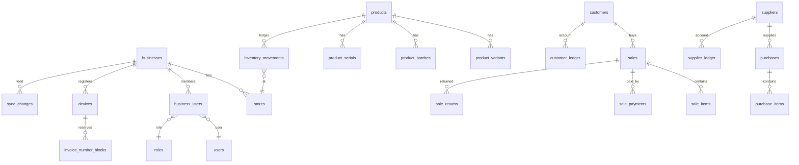

# Database

All primary keys are UUIDv7 strings generated on the device (server-generated for server-only
records). Money columns are `decimal(15,2)`, quantities `decimal(15,3)`, rates `decimal(8,3)`.
Business-owned tables carry `business_id`, `version` (optimistic concurrency) and timestamps; master
data uses soft deletes (`deleted_at`).

Migrations live in `apps/api/database/migrations` and run on SQLite (development/tests),
MySQL 8 / MariaDB 10.6+ and PostgreSQL 14+.

## Server tables

| Area | Tables |
| --- | --- |
| Identity | `users`, `personal_access_tokens`, `sessions` |
| Tenancy | `businesses`, `business_settings` (key → JSON), `stores`, `business_users` (member, role, store access), `roles`, `permissions`, `permission_role`, `devices` (code like `C1`, status) |
| Catalog | `categories`, `brands`, `units`, `tax_rates`, `products` (attributes JSON for industry fields, modifiers, price tiers), `product_variants`, `product_barcodes`, `product_prices`, `product_batches`, `product_serials` (IMEI/serial status) |
| Inventory | `inventory` (cached qty + avg cost per store/product/variant/batch, `stock_key` unique), `inventory_movements` (immutable ledger), `stock_adjustments`, `stock_transfers` |
| Parties | `customers`, `customer_addresses`, `customer_ledger` (debit = owes; also loyalty `points`), `suppliers`, `supplier_ledger` (credit = owed) |
| Sales | `sales` (invoices and quotation/estimate/proforma/challan, `review_flags`), `sale_items`, `sale_payments`, `sale_returns`, `sale_return_items`, `customer_payments`, `coupons` |
| Numbering | `invoice_sequences` (per business/type/period/series), `invoice_number_blocks` (reserved per device), `invoices` (document register, unique final numbers) |
| Purchases | `purchases` (orders and bills), `purchase_items`, `purchase_payments`, `purchase_returns`, `purchase_return_items`, `supplier_payments` |
| Finance | `expense_categories`, `expenses`, `cash_registers` (shifts), `cash_transactions` |
| Industry | `restaurant_tables`, `kitchen_orders` (KOT), `metal_rates`, `jewellery_orders`, `old_gold_purchases` |
| Sync & audit | `sync_operations` (unique `operation_id` → idempotency), `sync_conflicts`, `sync_changes` (change feed; id = pull cursor), `audit_logs`, `app_notifications`, `attachments` |

Invariants enforced by the services:
- Stock changes only through `inventory_movements`; `inventory.qty` is updated by delta under a row
  lock in the same transaction.
- Customer/supplier balances change only through ledger entries.
- Final document numbers are inserted into `invoices` (unique `business_id, document_type, number`).
- Every write transaction first locks the business row (`BusinessLock`), giving a monotonic change feed.

## Device (IndexedDB)

- Global DB `shopdesk`: `accounts` (user, token, offline verifier, memberships), `meta`.
- One DB per business `shopdesk-biz-{businessId}` with the same entities as the server plus:
  `sync_queue` (outbox), `sync_conflicts`, `number_blocks`, `held_sales` (local only),
  `attachments` (receipt files awaiting upload), `meta` (cursor, device id, counters).
- Local-only helper fields: `_pending` (record has unsynced changes), `codes`/`search` (product
  lookup indexes), `stock_levels.server_qty`, `inventory_movements.synced`.
- Schema changes add a new `this.version(n)` block in `apps/web/src/lib/db/business.ts`; released
  versions are never edited.
