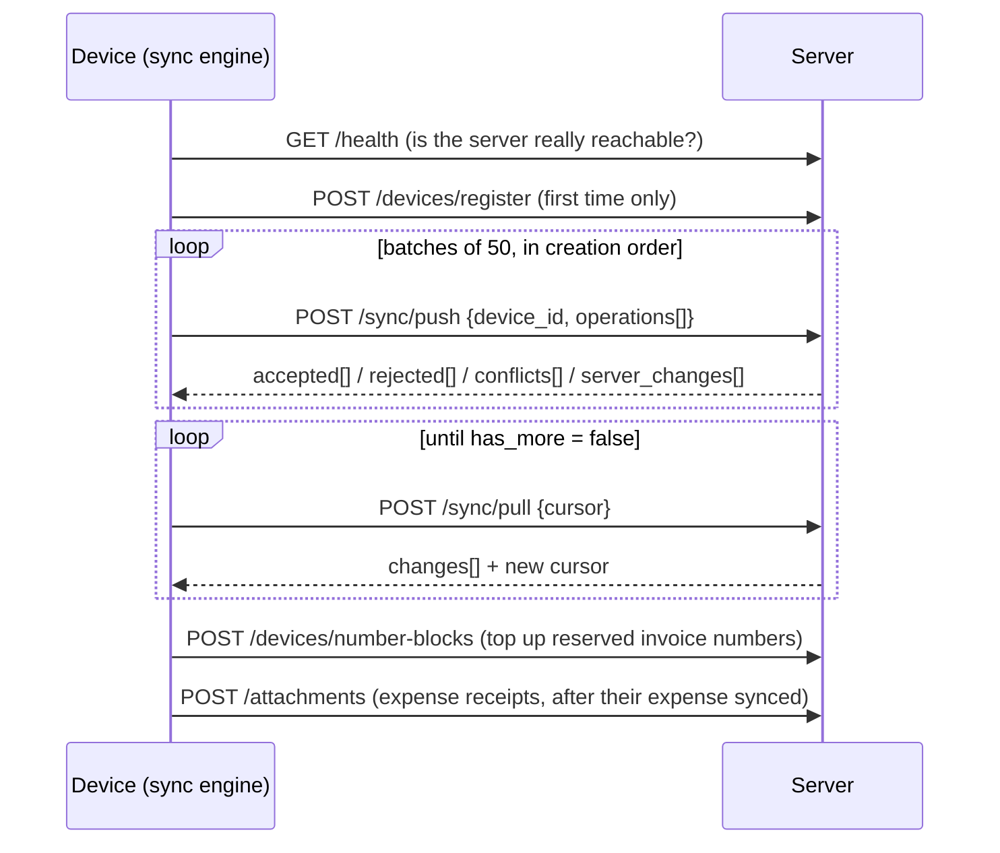

# Offline operation & synchronization

## Principles

1. Every write happens locally first, inside one IndexedDB transaction that stores the record(s)
   **and** an operation in `sync_queue` (the outbox). A crash can never leave one without the other.
2. Online status is decided by real requests (`GET /api/v1/health` with a short timeout), not by
   `navigator.onLine` alone.
3. Every operation has a unique `operation_id`; the server stores processed ids
   (`sync_operations.operation_id` is unique), so replays are harmless.
4. Financial records (sales, returns, payments, purchases, expenses, register shifts) are
   append-only. They are never rejected for business-rule anomalies made offline; the server
   records them and adds `review_flags` (e.g. `credit_limit_exceeded`, `expired_batch_sold`) plus a
   notification for a manager.
5. Master data (products, customers, settings…) uses field-level conflict detection.

## Outbox item

```json
{
  "operation_id": "uuid",
  "operation": "CREATE_SALE",
  "entity_type": "sale",
  "entity_id": "uuid",
  "payload": { "...": "..." },
  "base_version": null,
  "status": "pending | syncing | synced | failed | conflict",
  "retry_count": 0,
  "next_attempt_at": null,
  "device_id": "uuid",
  "user_id": "uuid",
  "last_error": null
}
```

Operations: `CREATE_/UPDATE_/DELETE_` for category, brand, unit, tax rate, product, customer,
supplier, expense category, restaurant table; `CREATE_PRODUCT_BATCH`, `CREATE_SALE`,
`UPDATE_QUOTATION`, `CANCEL_SALE`, `CREATE_SALE_RETURN`, `CREATE_PURCHASE`, `RECEIVE_PURCHASE`,
`CANCEL_PURCHASE`, `CREATE_PURCHASE_RETURN`, `CREATE_STOCK_ADJUSTMENT`, `CREATE_STOCK_TRANSFER`,
`RECEIVE_STOCK_TRANSFER`, `CREATE_CUSTOMER_PAYMENT`, `CREATE_SUPPLIER_PAYMENT`, `CREATE_EXPENSE`,
`VOID_EXPENSE`, `OPEN_CASH_REGISTER`, `CLOSE_CASH_REGISTER`, `CREATE_CASH_TRANSACTION`,
`CREATE_KITCHEN_ORDER`, `UPDATE_KITCHEN_ORDER_STATUS`, `CREATE_METAL_RATE`,
`CREATE/UPDATE_JEWELLERY_ORDER`, `CREATE/UPDATE_COUPON`, `UPDATE_SETTING`, `RESOLVE_CONFLICT`.

## Sync cycle



Triggers: app start, coming online, tab becoming visible, a local change (debounced 600 ms), every
60 s, a Background Sync event from the service worker, and the **Sync now** button. One sync runs
at a time across tabs (Web Locks).

Results per operation:

| Server result | Device |
| --- | --- |
| accepted / duplicate | `synced` (pruned after 3 days); stock movements marked confirmed |
| rejected, retryable (e.g. dependency not synced yet, server busy) | stays `pending`, exponential backoff with jitter (2 s … 5 min); after 12 attempts → `failed` |
| rejected, permanent (validation, permission) | `failed` with the server message; visible in Sync Center (Retry / Discard for non-financial data). The server keeps the rejected payload; a retry with the same `operation_id` is evaluated again (the earlier rejection is audited). |
| conflict | `conflict` + record in Conflict Center |
| network error / timeout | stays `pending`; engine shows Offline and retries with backoff |
| 401 | stays `pending`; banner asks the user to sign in again — billing continues |

## Pull and convergence

The server appends to `sync_changes` (bigint id = cursor) inside the same transaction as the data
change. A per-business row lock (`BusinessLock`) is taken first in every write transaction so feed
ids are assigned in commit order — a device can never skip a change committed "late".

On the device, `applyChanges` puts pulled records over local copies (same ids). For master data,
local edits still pending in the outbox are re-applied on top so they are not visually lost.

**Stock:** the server keeps an immutable ledger (`inventory_movements`) and a cached quantity
(`inventory`). The device stores `server_qty` (last confirmed) and shows
`qty = server_qty + Σ unconfirmed local movements`. Two tills selling the same item offline both
converge to the correct total after sync because the server sums movements; nothing is overwritten.

## Conflicts

Updates send `{ changes, base }` (only changed fields and their previous values) plus
`base_version`. The server compares `base` with current values per field:

- different fields changed on two devices → both applied (no conflict)
- the same field changed to different values → conflict for that field; other fields still apply
- record deleted on the server → `deleted` conflict

The Conflict Center shows base / this device / server values. **Keep this device's values** sends a
forced update; **Keep server values** accepts the server copy; IMEI sold twice and similar business
conflicts are **reviewed** by a manager.

## Invoice numbers offline

Invoice numbers must be unique and (for GST) sequential. Devices reserve blocks while online:

1. `POST /devices/number-blocks` reserves e.g. 50 numbers for `sale` for the current period
   (`invoice_number_blocks`), topped up when fewer than 30 % remain.
2. Offline, the device issues the next number from its block — a **final** number such as
   `INV-2026-000041` — inside the sale's transaction.
3. If the block runs out while offline, the device issues a **provisional** number
   `TMP-C1-00001` (C1 = device code). The server assigns the next final number when the sale
   syncs; the device receives it in the pull and the receipt can be reprinted. Provisional numbers
   are shown as "Temporary no." everywhere.
4. Every final number is registered in the `invoices` document register (unique per business), so a
   number can never be used twice.

Formats support `{YYYY} {YY} {MM} {FY} {FYY} {STORE} {DEVICE} {SEQ:n}`. A format containing
`{DEVICE}` gives each device its own gap-free series.

## Offline sign-in

After an online sign-in, a PBKDF2-SHA256 (150 000 iterations) password verifier is stored in the
global IndexedDB. Offline, the same credentials unlock the app on that device. The API token is
kept per account; if it expires, work continues and a banner asks for an online sign-in.

## Data safety tools

- **Sync Center**: pending / failed / conflict counts, errors, retry, discard (non-financial only).
- **Device backup** (Settings → Backup): JSON of everything on the device including unsynced
  operations. Restore merges records and re-queues unsynced operations; the server ignores ones it
  already has.
- Signing out warns when unsynced changes exist.
